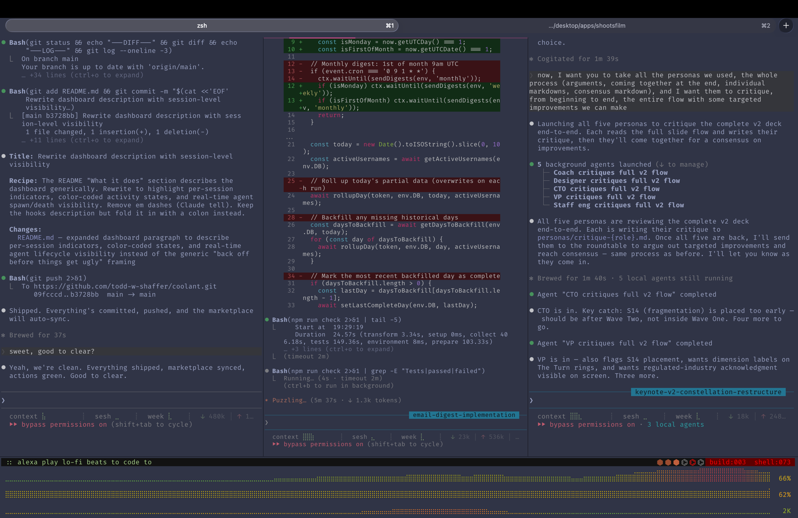
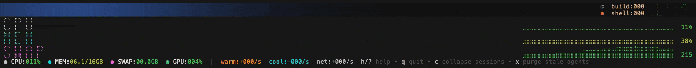
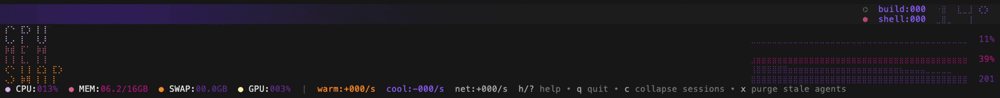
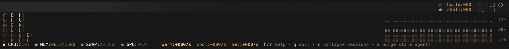
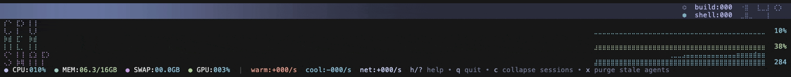

# coolant

A resource management layer for Claude Code -- prevents machines from melting when parallel agents run unthrottled.



## What it does

Run five Claude Code agents in parallel and your machine will try to compile, test, and lint everything at once. CPU pins, memory fills, the compressor spikes, and your whole system locks up. Coolant stops that.

The **dashboard** gives you a real-time read on system pressure. Each Claude Code session gets its own diamond, color-coded by escalation phase: idle (gray), language runtime spinning up (yellow), build tools running (orange), or full shell explosion (red, 30+ processes). Active subagents show as breathing hexagons on the headline bar. Spawn and death rates scroll through the display so you can see churn, not just snapshots. You see the state of your machine at a glance, not after the freeze. The **work queue** handles the rest: every test suite, typecheck, lint and build on the machine goes through one door, so parallel sessions take turns instead of all running at once and each running three times slower. You get the throughput of parallel agents without the meltdown.

## Quick start

```bash
# Add the marketplace (one time)
claude plugin marketplace add todd-w-shaffer/marketplace

# Install the plugin
claude plugin install coolant@todd-w-shaffer

# Install the dashboard (macOS only)
curl -fsSL https://raw.githubusercontent.com/todd-w-shaffer/coolant/main/install.sh | bash

# See it in action
thermo --demo
```

The dashboard installer also offers to set up the status line and patch `~/.claude/settings.json` for you. To update both later, run `install.sh --upgrade`.









## The dashboard

A single bottom-strip panel designed for a tmux split alongside your Claude Code session. Glance down, know the state.

- **Am I about to lock up?** -- CPU, MEM, and SWAP sparklines with severity coloring. Green is fine, yellow means watch it, red means act now.
- **Which session is the problem?** -- Each diamond is a Claude Code session. Color tracks the compilation dance: idle (gray), language spinning up (yellow), build tools running (orange), shell explosion (red, 30+ processes).
- **How many agents are running?** -- Breathing hexagons on the headline, one per active subagent. Pulsing means alive.
- **How much battery is left?** -- Braille fuel gauge with severity coloring and time remaining. Charging shows a breathing ⚡. Collapses on desktops with no battery.
- **What's eating resources?** -- Live process counts by category (`build:003 shell:087`). Runtime labels (`node`, `go`, `rust`) appear when those processes are active and disappear when they're not.
- **System vitals** -- CPU/MEM/SWAP/GPU gauges, spawn/death rates, network connectivity.

Keyboard shortcuts: `h` help overlay, `q` quit.

## The statusline

The installer also offers a status line for Claude Code itself -- a single row under your prompt, rendered in every session.

```
Opus 5 │ context ⣿⣿⣿⣷⠀⠀⠀⠀⠀⠀⡇  sesh ⣿⣿⣧⠀⠀⡇  week ⣿⣿⣿⣷⠀⡇  ⟳ 2:00 │ +$113 │ ↓ 187.4m │ ↑ 444k │  main
```

- **What model am I on?** -- leads the line, so a silent switch or a fallback is obvious at a glance.
- **How full is the context?** -- braille bar with the same thermometer coloring as the dashboard.
- **What has this session used?** -- cumulative tokens in and out, and a cost figure computed from the transcript.
- **How much plan headroom is left?** -- 5-hour and weekly bars plus a countdown to the next reset.

That last one -- the `sesh` and `week` bars and the reset countdown -- is a Claude.ai Pro/Max signal, and simply isn't sent on Amazon Bedrock, Vertex AI, or plain API-key auth. Rather than show two bars that can never fill, the status line detects that and drops them, so it stays useful on every provider.

The cost figure is computed locally at public list prices, priced per message from each message's own model and per billing bucket -- cache reads bill at a tenth of the input rate and dominate any long session, so pricing the combined token total instead overstates by roughly 8x. It reads `≈$` off subscription, where it estimates real marginal spend, and `+$` on Pro/Max, where the fee is flat and the number is value drawn against it rather than a bill.

## Hooks

Five agents each running `vitest`, `tsc`, and `eslint` means 15 build processes fighting for the same cores. Two whole test suites side by side take longer than the same two run back to back. Coolant prevents that with one machine-wide work queue:

- **One door for heavy work.** `coolant run --class <suite|files|typecheck|lint|check|build> -- <command>` runs a job through the queue and answers its exit status. Scripts, git hooks and test configs call it directly; commands typed into Claude Code are routed into it by the gate.
- **Interactive first, then first come, first served.** Your own session goes to the front of the waiting line; launcher-driven sessions marked with `COOLANT_LANE` wait their turn. A running job is never stopped, and no wait has a timeout — a wait ends when the work ahead ends.
- **Observe, then enforce.** The queue ships in observe mode: every job is recorded (`~/.coolant/runs.jsonl` — wall time, CPU, peak memory of the whole process tree, load) and nothing waits. Switch `[queue] mode = "enforce"` in `~/.config/coolant/config.toml` once the records show your budget. `coolant queue` shows what is running and waiting, with estimates. Interface: [`docs/work-queue.md`](docs/work-queue.md).
- **Agent lifecycles are tracked.** Hooks fire on spawn and death, feeding the dashboard and keeping concurrency limits accurate. Stale counters from crashed agents are reconciled automatically.

| Hook | Script | What it does |
|------|--------|--------------|
| SessionStart | `preflight.sh` | Warns about missing worktree exclusions |
| PreToolUse | `gate.sh` | Routes typed test runners, type checkers, linters and builds into the work queue |
| SubagentStart | `agent-start.sh` | Increments agent counter, emits JSONL event |
| SubagentStop | `agent-stop.sh` | Decrements counter, emits per-agent telemetry |
| SessionEnd | `session-end.sh` | Emits a session-end event so session duration is measured, not inferred |

<details>
<summary>How the gate works</summary>

The gate rewrites a typed heavy command to `coolant run --class <class> -- <command>`. Test runners go to `suite`, or `files` when the command names test files; `tsc`/`mypy` go to `typecheck`; linters to `lint`; bundlers and compilers to `build`. The door is a prefix, so `vitest run 2>&1 | tail -4` queues vitest and leaves the pipe as typed. Wrappers (`npx tsc`, `env vitest`) and path prefixes are recognized and kept. Where the command uses shell the gate won't parse — command substitution, subshells, backslashes — it leaves the command alone rather than risk running something other than what was typed.
</details>

## Skills

`/coolant` -- Show the work queue: what is running, what is waiting and in what order, with estimates from past runs.

## Requirements

- **macOS** -- the dashboard uses native system APIs (mach kernel, vm_stat, sysctl). Prebuilt binaries for Apple Silicon and Intel.
- **bash 3.2+** -- hooks only, ships with macOS
- **jq** -- required by the status line; the hooks and dashboard work without it
- **tmux** -- optional, for running the dashboard in a bottom split pane. Enable `set -g mouse on` in `~/.tmux.conf` for headline click-to-filter. Use Option-drag (macOS) to copy text while mouse capture is active, or press `m` to toggle mouse mode off.

Hooks work on any platform with bash. The thermal dashboard is macOS-only.

## Recommendations

- [Ghostty](https://github.com/ghostty-org/ghostty) -- looks great full-width
- [Catppuccin Frappé](https://github.com/catppuccin/catppuccin) -- the color palette the dashboard was designed against
- [FiraCode Nerd Font Mono](https://www.nerdfonts.com) -- braille characters and glyphs render cleanly

## Project structure

```
hooks/              # bash hook definitions
scripts/            # hook implementations + shared config
thermal/            # Go thermal dashboard (bubbletea)
claude-statusline/  # braille status line for Claude Code
skills/             # /coolant skill
tests/              # bats test suite
docs/               # design docs and backlog specs
assets/             # VHS tapes + demo GIFs
```

## License

MIT
